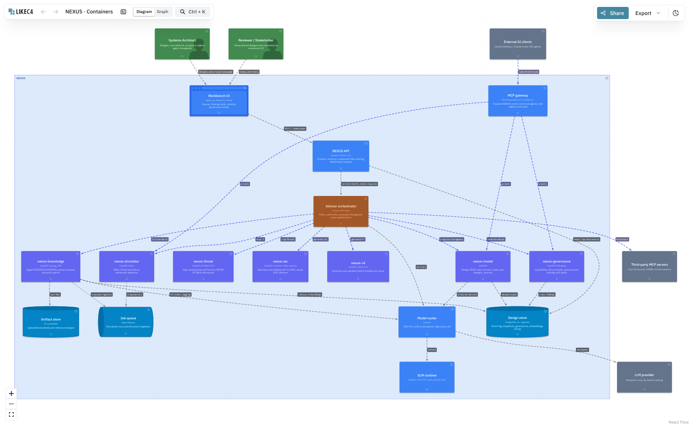

# NEXUS — Architecture

The model lives in `architecture/likec4/nexus.c4`; rendered views are in
`architecture/diagrams/`.

## Core idea

One versioned design model; every capability is an MCP server around it. The
canvas, the console, the orchestrator agent and external AI clients all change
the design through the same tools.

## Containers

| Container | Technology | Responsibility |
| --------- | ---------- | -------------- |
| Workbench UI | Next.js 16, React 19 | Canvas, floating cards, console, governance panes |
| NEXUS API | FastAPI | Projects, versions, IDs, sharing, WebSocket updates |
| MCP gateway | MCP Streamable HTTP, OAuth 2.1 | Exposes NEXUS tools to external agents; registry, audit |
| Advisor orchestrator | Python, MCP client | Plans, calls tools, proposes changesets |
| Model router | LiteLLM | SLM first, LLM on escalation; logs every call |
| SLM runtime | Ollama / vLLM | Phi-4-mini, Qwen2.5 3B |
| nexus-model | FastMCP | Design CRUD, sub-designs, versions |
| nexus-simulator | FastMCP, SimPy | What-if load and failure, bottlenecks |
| nexus-governance | FastMCP, OPA/Rego | Capabilities, EA principles, ground truth → findings |
| nexus-knowledge | FastMCP, Docling, OCR | Document ingestion, clause extraction, search |
| nexus-threat | FastMCP, ATT&CK STIX | Threat mapping |
| nexus-iac | FastMCP, Terraform, tflint, checkov | IaC generation and validation |
| nexus-c4 | FastMCP, LikeC4 CLI | C4 generation and validation |
| Design store | PostgreSQL 16 + pgvector | Event log, snapshots, governance, embeddings, AI log |
| Artifact store | S3-compatible | Uploaded files |
| Job queue | Redis Streams | Simulations, ingestion |

