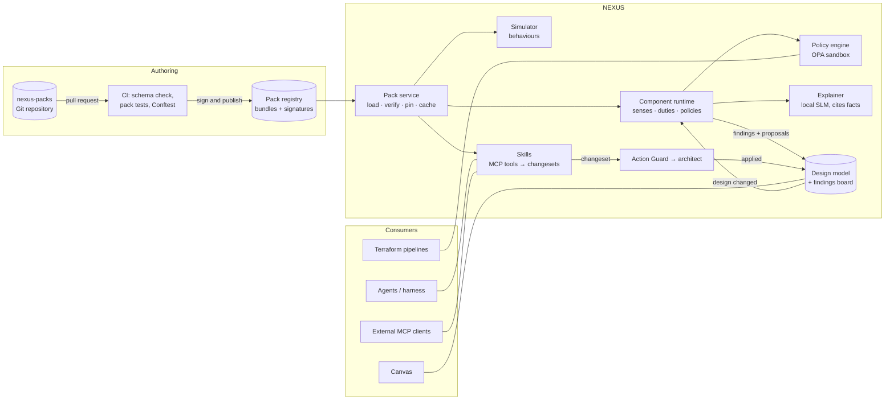

# Design: externalized knowledge packs and component intelligence

Status: **P1 started in v0.3.4** (packs in `packs/`, evaluated in the browser; see below) · Author: Joel Dizon, with Claude · November 2026
Related: [ROADMAP](../ROADMAP.md) (WP1 governance server, WP3 topology, WP6 provider packs),
[DECISIONS](../DECISIONS.md) D37–D44

## 0. What is built (v0.3.4)

- `packs/`: 21 vendor packs (facts with default, minimum, maximum, adjustable,
  source, date checked) and `core.placement` (subnets, zones, regions).
  `aws.dns` carries the three Route 53 rules from section 4.6.
- `packs/runtime.js`: facts, placement verdicts (best / ok / poor / no),
  findings and "think" for one component. Deterministic; no model; no network.
- `packs/build.mjs` validates and inlines the packs into the canvas;
  `packs/tests/` and `backend/tests/test_packs.py` are the pack tests.
- Not yet: the registry, signing, channels, OPA/Rego (named checks stand in),
  the governance MCP server, layers above vendor. Those stay as phased below.

## 1. Summary

Today, NEXUS's knowledge is written into the canvas code: what each component does, the
best-practice rules, the guardrails and the simulator's behaviour. This design moves it into
**packs**: versioned, tested and owned bundles of facts, skills, policies, guardrails and
behaviours, which NEXUS loads at runtime.

A **component runtime** uses the packs to make every component "aware":
- on every change, each affected component checks itself and its neighbours;
- it raises findings with proposed fixes and explains them with citations;
- the architect still decides.

The principles stay as they are:
- the design model is the single source of truth;
- rules decide and models explain;
- agents and components propose; only an architect applies.

### Goals
- Architects, security and platform teams change knowledge and rules **without a NEXUS
  release**, through review, with tests.
- Every finding says **which pack and version** raised it and **which source** it rests on.
- The **same packs** serve the canvas, the agents, external MCP clients and CI, including
  checks on real Terraform.
- Components behave realistically in the simulator: the DNS failover timeline, database
  failover time, queue back-pressure.

### Non-goals
- No language model per component. Models explain findings and draft options; they never
  decide a finding or its severity.
- No arbitrary code in packs. Packs are data plus sandboxed policies.
- No automatic changes. Skills produce changesets for the Action Guard and the architect.

## 2. Concepts

| Concept | What it is | Who owns it | Example |
|---|---|---|---|
| **Pack** | A versioned bundle for one subject: a component type, a guardrail set, or an organisation's standards | The team named in its manifest | `aws.dns@1.4.0` |
| **Fact** | A vendor limit, default or behaviour, with its source and the date it was last checked | Pack owner | Route 53 health checks every 30 s by default (10 s fast), unhealthy after 3 failures |
| **Sense** | A query that tells a component about itself and its surroundings in the design model | Pack owner | "my records and their targets", "the design's RTO" |
| **Behaviour** | A parameterised formula the simulator runs for this component | Pack owner | failover time = interval × threshold + TTL + client cache |
| **Duty** | What a component needs from its neighbours (a contract) | Pack owner | "each primary target gives me a health signal" |
| **Policy** | A rule that raises a finding of some severity, with an optional fix | Pack owner | "failover record without a health check" (critical) |
| **Guardrail** | A policy marked as blocking. It stops a change unless an exception is approved | Security, risk, EA | "internet-facing endpoint without a WAF" |
| **Skill** | An action a component or agent can propose, as declarative operations on the design | Pack owner | "use an alarm-based health check for DNS1 → ALB1" |
| **Layer** | Where a pack sits in the precedence order | Platform owner | vendor → industry → organisation → project |

## 3. Architecture



### Building blocks

| Block | Responsibility | Where it runs |
|---|---|---|
| **Pack repository** | Source of truth for packs. Code owners per folder; pull-request review | Git (`nexus-packs`) |
| **CI** | Validates manifests against JSON Schema, runs each pack's tests, runs Conftest over sample Terraform, then signs and publishes | GitHub Actions |
| **Pack registry** | Stores signed bundles (OCI artifacts or plain tarballs) on two channels: `stable` and `next` | OCI registry or object store |
| **Pack service** | Loads bundles, verifies signatures, resolves layers, pins versions per project, caches, and exposes `packs.*` tools | Governance MCP server (WP1) |
| **Component runtime** | On each change, works out the affected components, runs their senses, duties and policies, and posts findings | Governance MCP server |
| **Policy engine** | Evaluates Rego in a sandbox: no network (`http.send` off), time and memory limits | Embedded OPA |
| **Simulator** | Uses each pack's behaviours: failover timelines, detection time, quotas | Simulator MCP server |
| **Skills** | Turns a finding's fix into a changeset of model operations. Never applies it | Model MCP server |
| **Explainer** | Writes the finding in plain words from the pack's facts, with citations; no new claims | Router → local SLM |
| **Findings board** | Findings stored with the design version, pack@version, sources and status | PostgreSQL |

## 4. Pack format

```
components/aws/dns/
  pack.yaml          manifest: id, version, owner, layer, applies to, depends on
  facts.yaml         cited facts
  senses.yaml        what the component reads from the design model
  behaviour.yaml     formulas for the simulator
  duties.yaml        what it needs from neighbours
  policies.rego      findings and guardrails
  skills.yaml        proposed fixes as model operations
  explain.md         wording hints for the explainer (optional)
  tests/             designs that must raise or must not raise each finding
```

### 4.1 Manifest

```yaml
id: aws.dns
version: 1.4.0
title: Amazon Route 53 (DNS traffic steering)
owner: team-network            # code owner; reviews every change
layer: vendor                  # vendor | industry | organisation | project
applies_to: { type: dns, platform: aws }
depends_on: [aws.lb@^1.2, aws.mon@^1.0]
schema: nexus-pack/1
```

### 4.2 Facts (cited, dated)

```yaml
- id: hc.interval
  value: { default_s: 30, fast_s: 10 }
  source: https://docs.aws.amazon.com/Route53/latest/DeveloperGuide/dns-failover-determining-health-of-endpoints.html
  checked: 2026-11-06
- id: hc.failure_threshold
  value: { default: 3, min: 1, max: 10 }
  source: (same page)
  checked: 2026-11-06
- id: hc.evaluate_target_health
  value: "Alias records can inherit the target's health (for example an ELB) instead of probing it"
  source: https://docs.aws.amazon.com/Route53/latest/DeveloperGuide/dns-failover-simple-configs.html
- id: hc.cloudwatch_alarm
  value: "A health check can follow a CloudWatch alarm; the 'insufficient data' status is configurable"
  source: https://docs.aws.amazon.com/Route53/latest/DeveloperGuide/health-checks-creating-values.html
- id: hc.private_endpoints
  value: "Health checkers probe from the internet and cannot reach private endpoints"
  source: (pack owner to confirm and cite)
```

Facts are reviewed like code. A fact that is older than its pack's review period (say six
months) raises a "fact needs re-checking" task for the owner, and findings that rely on it
show the date.

### 4.3 Senses

```yaml
records:  "edges from this DNS node to its targets, with routing policy, TTL and health settings"
targets:  "for each target: type, public or private, region, whether it is an alias"
design:   "requirement targets (availability, RTO, RPO), regions mode, outage scenario"
```

Senses are read-only queries over the design model. The runtime computes them once per change
and hands them to the policies as `input`.

### 4.4 Behaviour (for the simulator)

```yaml
detection_s:  "interval_s * failure_threshold"                     # 90 by default, 30 with fast checks
failover_s:   "detection_s + ttl_s + client_cache_s"
during_failover: { traffic_to_failed_target: 1.0 }                  # errors count until failover_s
after_failover:  { route_to: healthy_secondary_or_default }
```

Formulas use a small expression language (CEL) over facts and senses. When you run
`fail region a`, the simulator plays a **timeline**: outage, then unhealthy, then the TTL
expires, then traffic moves. Errors in the window count toward the outage.

### 4.5 Duties

```yaml
- id: health_signal
  for: each primary target
  needs: one of [evaluate_target_health, endpoint_probe, cloudwatch_alarm, calculated]
  prefer:
    - when: target.is_alias and target.type in [lb, cdn, gw]   then: evaluate_target_health
    - when: target.private                                    then: cloudwatch_alarm
    - when: target.public                                     then: endpoint_probe
```

### 4.6 Policies and guardrails (Rego)

```rego
package nexus.aws.dns

# Failover without a health signal sends users to a dead region.
finding[f] {
  r := input.records[_]
  r.policy == "failover"
  not r.health
  f := {"id": "dns.failover-without-health", "severity": "critical", "on": r.id,
        "facts": ["hc.evaluate_target_health", "hc.interval"],
        "fix": {"skill": "dns.add-health-signal", "args": {"record": r.id}}}
}

# The requirement's RTO is shorter than detection plus TTL.
finding[f] {
  t := input.design.targets.rto_s
  d := input.behaviour.failover_s
  d > t
  f := {"id": "dns.failover-slower-than-rto", "severity": "high",
        "detail": sprintf("failover takes about %ds; the RTO is %ds", [d, t]),
        "fix": {"skill": "dns.fast-checks-low-ttl"}}
}

# Probing a private endpoint cannot work.
finding[f] {
  r := input.records[_]; r.health == "endpoint_probe"; r.target.private
  f := {"id": "dns.probe-private-endpoint", "severity": "high",
        "facts": ["hc.private_endpoints", "hc.cloudwatch_alarm"],
        "fix": {"skill": "dns.alarm-health-check", "args": {"record": r.id}}}
}
```

A guardrail is a policy with `blocking: true` in the guardrail set. The Action Guard refuses
the change unless an exception is written and approved, as it does with ground truth today.

### 4.7 Skills

```yaml
- id: dns.alarm-health-check
  title: Use a heartbeat alarm as the health check
  ops:                                          # declarative model operations only
    - { op: set,  id: "{record}", field: health, value: cloudwatch_alarm }
    - { op: ensure_dep, from: "{target}", to_type: mon, why: "heartbeat metric and alarm" }
    - { op: set,  id: "{record}", field: insufficient_data, value: unhealthy }
  tradeoffs:
    - "+ Works for private endpoints and push heartbeats"
    - "− Depends on the alarm's period: detection is slower than fast probes"
  cost: { per_month_usd: 0.5, note: "per health check; alarm and metric extra" }
```

Skills are exposed as MCP tools (for example `skills.propose("dns.alarm-health-check", …)`).
They return a changeset; the Action Guard dry-runs it, and the architect applies it.

### 4.8 Tests

```yaml
- name: failover without health is critical
  design: tests/designs/failover-no-health.json
  expect: { raises: [dns.failover-without-health] }
- name: alias to ALB with evaluate target health is clean
  design: tests/designs/alias-eth.json
  expect: { not_raises: [dns.failover-without-health] }
- name: failover timeline with defaults
  design: tests/designs/two-region.json
  expect: { behaviour: { failover_s: 150 } }            # 30 × 3 + 60 TTL
```

CI fails the pull request if a test fails, so a rule cannot silently block, or pass, every
design.

## 5. Evaluation flow

```mermaid
sequenceDiagram
  participant A as Architect / agent
  participant DM as Design model
  participant CR as Component runtime
  participant PE as Policy engine
  participant EX as Explainer (SLM)
  participant AG as Action Guard
  A->>DM: change (or simulation)
  DM->>CR: changed nodes and edges
  CR->>CR: affected set = changed + neighbours + dependants
  CR->>PE: senses + facts + behaviour per component
  PE-->>CR: findings with fixes (pack@version, facts)
  CR->>DM: post findings to the board
  CR->>EX: explain findings (facts only, cited)
  A->>AG: accept a fix (skill → changeset)
  AG->>DM: dry-run; the architect applies it or not
```

- **Affected set:** the components that changed, their neighbours, and anything with a duty
  toward them. This keeps evaluation in milliseconds for designs with hundreds of components.
- **Determinism:** the same design and pack versions always give the same findings, so findings
  can be cached by (design version, pack lock).
- **Explanations** are generated on demand and cached. If the model is unavailable, the finding
  still stands, with the pack's own wording.

## 6. Layers and precedence

```
vendor (aws.*, azure.*, gcp.*, dc.*)  →  industry (mas-trm, pdpa, pci)  →  organisation (acme.*)  →  project exceptions
```

- A higher layer may **tighten** a lower one: add rules, raise severity, lower a limit.
- **Loosening** (lowering severity, disabling a rule) needs an approved **exception**, which
  has an owner, a reason and an expiry, and is recorded as an architecture decision.
- **Facts** can be overridden at organisation level (for example your negotiated quotas). The
  override is shown next to the vendor value.

## 7. Lifecycle

1. **Author:** edit a pack in a branch; tests sit next to the rules.
2. **Review:** the pack's code owners approve. Security owns guardrails, EA owns the
   organisation layer, platform teams own component packs.
3. **CI:** schema validation, pack tests, Conftest against sample Terraform, and a diff of the
   findings this change would cause on reference designs.
4. **Publish:** signed bundle to the `next` channel.
5. **Try:** pin `next` on a few projects; NEXUS shows "new findings under next" without
   enforcing them.
6. **Promote** to `stable`; every project on `stable` re-evaluates and shows what changed.
7. **Roll back** by re-pinning the previous version. Findings keep the version that raised
   them.

## 8. Security

- **Signed bundles** (Sigstore / cosign). NEXUS loads only bundles signed by the pack
  repository's CI.
- **Sandboxed policies:** OPA with `http.send` and other network built-ins disabled, plus CPU,
  memory and time limits per evaluation.
- **Declarative skills:** a fixed set of model operations (`add`, `connect`, `set`,
  `ensure_dep`…), validated by the design schema. No scripts, no shell, no network.
- **Prompt-injection resistant:** the explainer gets facts and findings as data. Pack text
  never becomes instructions to an agent, and the model cannot change a finding.
- **Audit:** loading, pinning, exceptions and every applied skill are recorded with who, when
  and which version.
- **Access:** publishing packs and approving exceptions are separate permissions, and use the
  same RBAC as projects.

## 9. Interfaces

**MCP tools** (governance server):

| Tool | Purpose |
|---|---|
| `packs.list` / `packs.get` | Browse packs, versions, owners and facts |
| `packs.pin` | Pin versions for a project (lead architect) |
| `design.evaluate` | Findings for a design version, with pack@version and facts |
| `component.think` | What one component knows, senses and concludes (for the Properties "Thinking" tab) |
| `skills.list` / `skills.propose` | Available fixes, and a changeset for one |
| `exceptions.request` / `exceptions.approve` | The guardrail exception workflow |

**Finding record:**

```json
{ "id": "dns.failover-slower-than-rto", "severity": "high", "on": "DNS1",
  "pack": "aws.dns@1.4.0", "facts": ["hc.interval", "hc.failure_threshold"],
  "detail": "failover takes about 150 s; the RTO is 60 s",
  "fix": { "skill": "dns.fast-checks-low-ttl", "changeset": "CS-41" },
  "explanation": { "model": "qwen2.5:7b-instruct", "text": "…", "cites": ["…"] },
  "design_version": 17, "status": "open" }
```

## 10. In the product

- **Properties → Thinking:** what the component knows (facts and dates), what it sees (senses),
  what it owes and is owed (duties), what it concluded (findings), and the fixes it offers.
- **Simulation timelines:** outage, detection, failover and recovery per component, so the
  RTO can be read off instead of assumed.
- **Packs page:** browse, search, see owners and versions, compare `next` with `stable`, and
  see which projects are affected by a change.
- **Advisor:** each finding shows its pack@version and a link to its source.

## 11. Migration and phasing

| Phase | Scope | Fits |
|---|---|---|
| **P0 · Extract** | Move today's ground truth, EA principles, capabilities and the built-in checks into the pack format, loaded from a folder. Same results; golden tests prove parity | Before WP1 |
| **P1 · DNS first** | Component runtime, the DNS pack with timeline behaviour, Properties → Thinking | With WP1 (governance server) |
| **P2 · Core packs** | Load balancer, database, queue and Generative AI packs; findings board in PostgreSQL | WP1–WP3 |
| **P3 · Registry** | Signed bundles, channels, pinning, the Packs page, the exception workflow | WP4 |
| **P4 · Beyond the canvas** | Conftest over real Terraform; industry packs (MAS TRM, PDPA); the knowledge server keeps facts fresh with citations | WP5–WP6 |

## 12. Alternatives considered

| Option | Why not (or not yet) |
|---|---|
| **A language model per component** | Slow, costly and non-deterministic; findings would differ run to run and cannot be tested. Models stay as explainers |
| **Rules in application code** (today) | Every change needs a developer and a release; owners cannot review their own rules; there is no per-rule versioning |
| **JSONLogic or a custom DSL** | Simpler, but weaker tooling and no path to checking real Terraform. OPA/Rego is widely used and has Conftest; CEL covers the small formulas |
| **Policies only, no facts** | Rules would hard-code vendor numbers with no source or date; facts make findings citable and easy to update |

## 13. Open questions

1. Rego for every rule, or CEL for simple checks and Rego for the rest?
2. Where packs are hosted: a GitHub repository with releases, or an OCI registry next to the
   container images?
3. Who approves organisation-level fact overrides (for example negotiated quotas)?
4. How long a fact may go without re-checking before it is flagged, per vendor?
5. Should industry packs (MAS TRM, PDPA) be authored in-house, or adopted from a community
   source and tightened?

## 14. Risks

| Risk | Mitigation |
|---|---|
| Rule sprawl and noisy findings | Severity discipline; tests with "must not raise"; finding-rate dashboards per pack |
| Stale vendor facts | `checked` dates, review periods, knowledge-server refresh with citations (P4) |
| A bad pack blocks everyone | `next` channel first, findings diff in CI, instant rollback by re-pinning |
| Owners do not maintain their packs | Code owners plus a "fact needs re-checking" queue in NEXUS |
