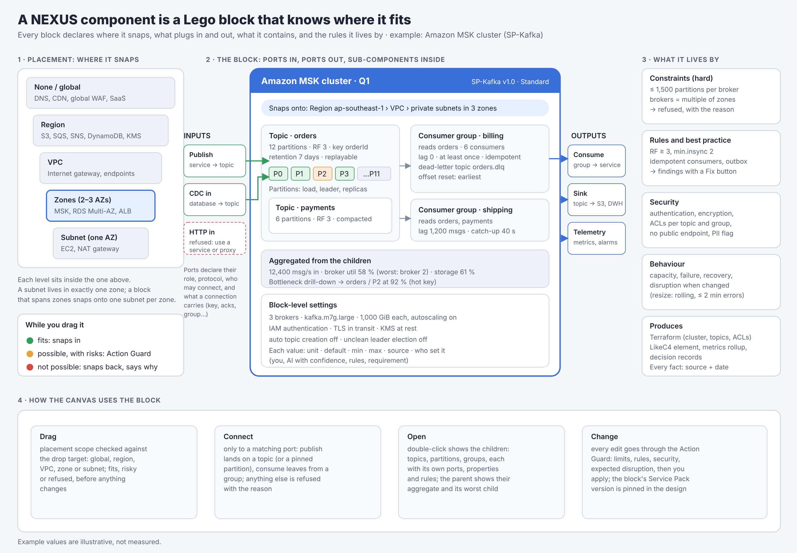
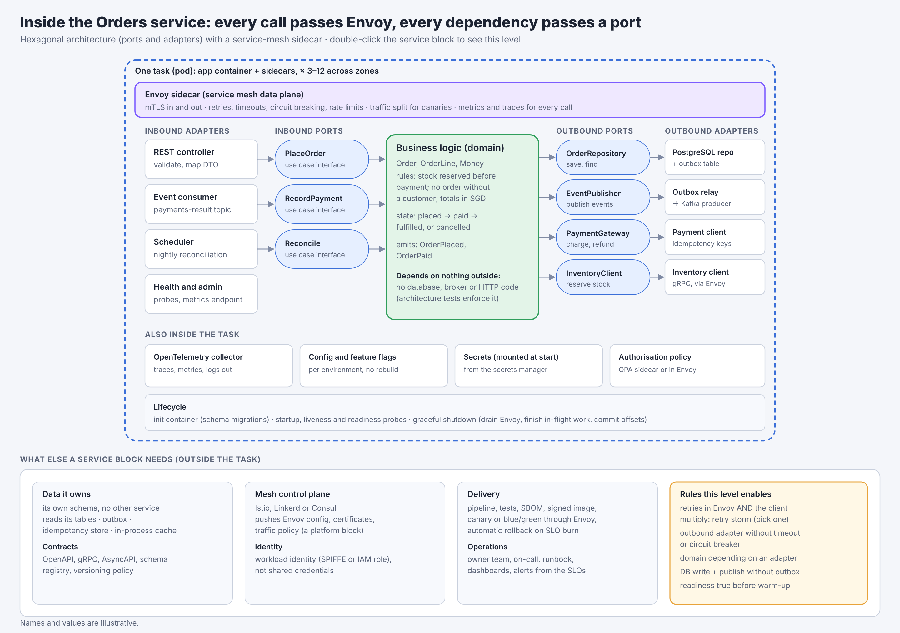
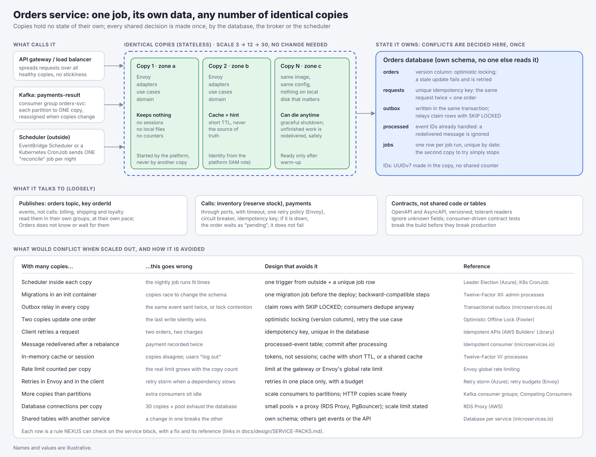

# Service Packs: one service at a time, done properly

Status: **proposed** (nothing built) · November 2026 · Related: [PACKS.md](PACKS.md), D45–D48

## 1. Why

Since v0.3.4 NEXUS has added breadth fast: many services, many rules, each a little. The result works
but is uneven: some services have sourced limits and tests, others planning guesses. From now on NEXUS
grows **one Service Pack (SP) at a time**. Each SP brings one service family to a defined standard, ships
on its own, and can be upgraded or rolled back without touching the others.

**Rule:** a new SP starts only when the previous one has reached **Standard** (level 2, section 5),
or has been explicitly parked.

## 2. What a Service Pack is

A Service Pack is everything NEXUS knows and does for one service family, across the providers it
supports. Example: **SP-Kafka**: Amazon MSK first, then Apache Kafka in the data centre, Azure Event
Hubs (Kafka API) and Google Cloud Managed Service for Apache Kafka.

| Part | What it holds | Form |
|---|---|---|
| **Model** | Component types and their children (cluster → topic → partition; consumer group), properties with types, units, min, max and default | JSON Schema |
| **Facts** | Provider limits, defaults and behaviours, each with an official source and a check date | JSON (as today's packs) |
| **Behaviour** | How the service acts in the simulator: capacity, assignment, failure, recovery | Declared formulas, plus one engine adapter in core code (reviewed like code) |
| **Rules** | Checks with severity, rationale, basis (Well-Architected pillar, standard), fix or "no automatic fix" | JSON now, OPA/Rego when the governance server lands |
| **Policy** | Organisation-level thresholds the rules read: minimum replication, maximum retention for personal data, naming | Organisation layer, overridable per project with an approved exception |
| **Placement** | Subnets, zones and regions it may use | Extends `core.placement` |
| **Integration** | Which components may connect to it, in which role (publish, consume, CDC, sink), and what each connection carries | Integration contract (section 4) |
| **Disruption** | What each change does to availability (resize, add brokers, more partitions) | Facts with `change` and `when` |
| **IaC** | Terraform/OpenTofu per component and per child, per provider | Templates, snapshot-tested |
| **C4** | How it appears in LikeC4 | Mapping |
| **Experience** | Inspector fields, drill-down views, labels, console commands, help text | Declared |
| **Tests** | Golden designs, rule tests (must and must not raise), simulation scenarios with expected numbers, IaC snapshots, browser checks | Run by `./poc/tests/run-all.sh` |
| **Docs** | README, test plan, changelog, known limits | Markdown |

```
packs/services/kafka/
  sp.json              id, version, level, owner, providers, depends on (core contract version, other SPs)
  model.schema.json    cluster, topic, partition, consumer group, connection properties
  facts/aws.json       MSK limits and behaviours, cited
  facts/vmware.json    self-hosted Apache Kafka defaults
  behaviour.json       formulas and the adapter name
  rules.json           checks, severities, fixes
  policy.defaults.json organisation thresholds (overridable)
  integration.json     allowed connections and their contracts
  disruption.json      change → outage, with sources
  iac/aws.tf.tmpl      aws_msk_cluster, aws_msk_configuration, kafka_topic, kafka_acl, alarms
  iac/vmware.tmpl      Strimzi (Kafka on Kubernetes) or brokers on VMs
  ui.json              inspector panels, drill-down, labels, console grammar
  tests/               golden designs, expected findings, simulation scenarios, IaC snapshots
  README.md · TEST-PLAN.md · CHANGELOG.md
```

## 3. The contracts every SP implements

The core (canvas, simulator, Action Guard, IaC, C4) talks to SPs only through these contracts, so an
SP can be upgraded without changing the core, and the core without breaking an SP.

| Contract | The SP provides | The core guarantees |
|---|---|---|
| **Component** | Types, child types, property schema, defaults | Drawing, selection, undo, provenance, persistence |
| **Connection** | Allowed roles per neighbour type (publish, consume, subscribe, CDC, sink), the settings each carries, refusals with reasons | Drawing, reconnect, Action Guard, labels |
| **Metrics** | For each child: rate in and out, utilisation, latency, lag, storage; a rollup function for the parent | Aggregation partition → topic → broker → cluster; worst-child drill-down; KPIs |
| **Findings** | Id, severity, target path (`Q1/orders/P7`), facts cited, fix as declarative operations | Advisor, fix buttons, history, decisions |
| **Disruption** | For each change type: outage range, mitigation, source | Expected disruption in the Action Guard, acknowledgement, maintenance window |
| **IaC** | Resources per component and child, deterministic names, no secrets | Assembly, ordering, export |
| **Migration** | How designs from its previous version load | Version pin per design; refuses unknown majors |

## 4. Integration contract

Every SP declares, for each other component type or SP, whether a connection is allowed and what it
means. Anything not declared is refused with a reason. Integration with another SP is tested in both
packs.

Example rows for SP-Kafka:

| From → to | Allowed | Means | Carries |
|---|---|---|---|
| Service, VM, function → **topic** | Yes | Publish | Key, partitioner, acks, idempotence, transactions, batching, compression, outbox |
| Service, VM, function → **partition** | Yes, with a warning | Publish to a pinned partition | As above; loses key-based placement |
| **Topic** → consumer group → service, VM, function | Yes | Consume | Group, concurrency, poll limits, commit mode, retries, retry topic, dead-letter topic, idempotency, ordering |
| **Partition** → service | Yes, with a warning | Manual assignment | No group rebalancing |
| Database → **topic** | Via a connector component (MSK Connect, Debezium) | Change data capture | Table, key, snapshot mode |
| **Topic** → object store, warehouse | Via a connector component | Sink | Format, batch size, delivery guarantee |
| API gateway, load balancer, users → **topic** | No | — | Refused: "Kafka has no HTTP entry point; publish from a service, or use a REST proxy component" |
| Anything → **cluster** | No | — | Refused: "connect to a topic (or a partition), not to the cluster" |

## 5. Maturity levels and the quality gate

| Level | Name | Visible to users | Must have |
|---|---|---|---|
| 0 | Draft | Behind a developer flag | Model and contracts compiled; owner named |
| 1 | Preview | Behind "Preview" in Settings; labelled "preview" on the canvas | Model, facts for its first provider (sourced), main rules with tests, IaC for its first provider, known limits listed |
| 2 | **Standard** | On by default | Everything in section 6 |
| 3 | Certified | Marked "certified" | Level 2, plus the simulator calibrated against real metrics from a pilot, and an organisation or industry policy set (for example PCI-DSS, PDPA) |

## 6. Definition of Done: the standard every SP meets at level 2

**Fidelity**
- Every number shown or used has an official source and a check date. Anything not confirmed is
  marked "not yet confirmed" or is a labelled NEXUS rule, never presented as a provider fact.
- The providers and variants supported are declared (for example MSK provisioned, MSK Serverless);
  anything else says plainly that it is not covered.

**Rules and policy**
- Every rule has an id, a one-sentence rationale, a severity, its basis, and a fix or an explicit
  "no automatic fix".
- Every rule has at least one design that must raise it and one that must not.
- Thresholds that are an organisation's choice live in policy, not in the rule.
- No rule fires on the starter designs without a real reason (noise is a defect).

**Behaviour**
- The simulation model is written down with its assumptions and what it ignores.
- Scenario tests with expected numbers: normal load, peak, a component failure, a zone failure,
  recovery and catch-up.
- Evaluation stays under 50 ms for a 500-component design (a budget, measured in CI).

**Integration**
- Every neighbour type is declared allowed (with its contract) or refused (with its reason).
- Tests for each allowed connection and each refusal.

**Governance**
- Every change goes through the Action Guard; every change that interrupts the service has a sourced
  disruption fact.
- Provenance on every value: you, AI with confidence, rules, requirement, default.

**IaC and C4**
- `terraform validate` passes in CI for each provider; snapshot tests for golden designs; no secrets;
  names are stable across runs.
- LikeC4 output validates.

**Experience**
- Every field shows its unit, default, minimum and maximum, and its source.
- Drill-down from parent to the child that is the bottleneck.
- Console commands have help text; wording passes a plain-language review.
- Keyboard and screen-reader basics for new panels.

**Compatibility**
- Designs saved with the previous SP version load and are migrated; a test proves it.
- The design records the SP version it was built with; rolling back means pinning the previous version.

**Documentation and review**
- README (what it covers, what it does not), test plan (manual steps a reviewer can follow),
  changelog, known limits.
- Two reviewers: the owner and one other. A recorded five-minute demo of the main scenario.

## 7. Rolling upgrades

- **Independent versions.** Each SP has its own semantic version; the core contract has its own.
  A core release never forces an SP release, and the reverse.
- **Pinned per design.** A design records the SP versions it uses (`packs.lock`). Upgrading a design
  is a change like any other: dry-run, findings diff ("this upgrade raises 2 new findings"), then
  apply. Rolling back is pinning the previous version.
- **Channels.** New SP versions go to Preview first, then Standard after the quality gate.
- **Release train.** One SP improvement at a time, each with its test plan; `./poc/tests/run-all.sh`
  must pass in Docker before anything is pushed.
- **Existing features.** What ships today (queue, notifications, DNS, CloudFront, databases…) becomes
  "legacy, level 1" and is brought to level 2 one SP at a time; nothing new is added to a legacy
  service until its SP is in progress.

## 8. SP-Kafka (first pack): requirements

**Scope for level 2:** Amazon MSK provisioned (Standard brokers) and Apache Kafka in the data centre.
MSK Serverless, Event Hubs (Kafka API) and Google Cloud Managed Kafka follow as later versions of the
same SP, each through Preview.

### 8.1 Model

| Component | Properties (unit, default from facts) |
|---|---|
| **Cluster** (container) | Brokers (multiple of zones), broker size, zones, storage per broker and autoscaling, Kafka version and metadata mode, encryption in transit and at rest, client authentication (IAM, SASL/SCRAM, mTLS), configuration (auto topic creation off, default replication, min.insync.replicas, unclean leader election off) |
| **Topic** (child) | Partitions, replication factor, min.insync.replicas, retention (time, size), cleanup (delete, compact), tiered storage, compression, maximum message size, key meaning, ordering required, schema reference, owner, personal-data flag |
| **Partition** (child of topic, derived, collapsed by default) | Leader broker, replicas, share of keys, rate in and out, lag per group |
| **Consumer group** (child) | Group id, member services, assignment strategy, offset reset, commit mode, isolation level, offset retention |
| **Publish connection** | Key, partitioner, acks, idempotence, transactions, batching, compression, outbox, expected keys and skew |
| **Consume connection** | Group, concurrency, processing time, poll limits, retries and backoff, retry topic, dead-letter topic, idempotency, ordering mode, pinned partitions |

### 8.2 Facts to verify before level 1 (official AWS and Apache Kafka pages)

Brokers per cluster · partitions per broker by broker size · broker throughput by size (the ceiling,
since provisioned MSK has no per-partition limit) · storage per broker and the scaling cooldown ·
broker-size change behaviour · adding brokers and partition reassignment · replication best practice ·
maximum message size default · consumer-group offset retention default · tiered storage support ·
MSK Replicator for a second region · MSK Connect for connectors · Lambda event source mapping for MSK
(batching, concurrency) · encryption and authentication options.

### 8.3 Behaviour

- Keys → partitions by hash share, from the expected key count and skew you enter (not guessed).
- Partitions → consumer instances by the chosen assignment strategy; rebalancing pause when members
  change.
- Broker load = traffic of the partitions it leads + replication traffic it receives; storage =
  rate × retention × replication factor.
- Lag over time = what arrives minus what the group processes; catch-up time after an outage.
- Failures: broker loss (leader election; writes refused if in-sync replicas drop below
  min.insync.replicas with acks=all), zone loss, region loss (with or without replication).
- Rollup partition → topic → broker → cluster; the parent shows the aggregate and its worst child.

### 8.4 Rules (curated; each tested)

| Id | Rule | Severity | Basis |
|---|---|---|---|
| kafka.zones | Brokers spread over at least 2 zones (3 recommended), count a multiple of the zones | Critical | Reliability |
| kafka.replication | Replication factor ≥ policy (3), min.insync.replicas ≥ 2 and < replication factor | High | Reliability, MSK best practice |
| kafka.unclean-election | Unclean leader election off | High | Reliability |
| kafka.partitions-per-broker | Within the documented recommendation for the broker size | Warning, critical above the maximum | MSK best practice |
| kafka.broker-ceiling | Broker throughput within its documented ceiling, with headroom per policy | Warning | Performance |
| kafka.hot-partition | No partition above policy share of the topic's traffic | Warning | Performance |
| kafka.idle-consumers | Consumers in a group ≤ partitions read | Info | Performance |
| kafka.lag-rto | Catch-up time after the planned outage ≤ RTO | High | Reliability |
| kafka.retention-outage | Retention ≥ longest planned consumer outage | High | Reliability |
| kafka.offset-retention | Offset retention ≥ longest planned consumer outage | Warning | Reliability |
| kafka.storage | Storage needed ≤ broker storage with policy headroom, autoscaling on | Warning | Operations |
| kafka.producer-durability | acks=all and idempotence for business events | High | Reliability |
| kafka.consumer-idempotency | At-least-once consumers are idempotent | Warning | Reliability |
| kafka.dead-letter | Every consumer group has its dead-letter topic (created by default, section 8.6a) and bounded retries | Warning | Operations |
| kafka.outbox | A service that writes its database and publishes uses an outbox | Warning | Reliability |
| kafka.ordering-key | Ordered topics are published with a key; consumers keep per-key order | Warning | Reliability |
| kafka.state-compaction | Topics holding current state are compacted | Info | Operations |
| kafka.pii-retention | Personal-data topics: retention within policy, erasure possible | High | Security, PDPA |
| kafka.auth-encryption | Client authentication on, encryption in transit and at rest | Critical | Security |
| kafka.naming-owner | Topic follows the naming policy and has an owner | Info | Operations |

### 8.5 Policy defaults (organisation layer, overridable with an approved exception)

Minimum replication factor 3 · min.insync.replicas 2 · dead-letter topic on, 3 retries with backoff, 14-day retention · broker headroom 30 % · storage headroom 20 % ·
hot-partition share 2× the average · personal-data retention per the data policy · naming
`<domain>.<entity>.<version>` · owner required.

### 8.6 Integration with other packs

| Pack | Contract |
|---|---|
| Compute (services, VMs, Kubernetes) | Publish and consume, client settings generated |
| Functions (Lambda) | Event source mapping: batch size, concurrency, failure destination |
| Databases | CDC into topics through a connector component |
| Object storage, warehouse | Sinks through a connector component |
| Networking | Private subnets, security groups, private connectivity between VPCs |
| Security | KMS keys, IAM policies or ACLs per topic and group |
| Observability | Lag, under-replicated partitions and storage alarms generated |

### 8.6a Dead-letter topic by default (decided November 2026)

Kafka has no built-in dead-letter queue; it is a convention: a separate topic the consumer writes a
failed message to (frameworks such as Spring Kafka and Kafka Connect's error handling do this). In
SP-Kafka every consume connection gets one **by default**.

| Item | Default | Why |
|---|---|---|
| When it is created | With each consumer group's first consume connection | No group without a place for failed messages |
| Name | `<topic>.<group>.dlq`, for example `orders.loyalty.dlq` | Groups fail for different reasons; one DLQ per group keeps them apart and owned |
| Where it appears | A child topic in the cluster, drawn under its source topic with a DLQ badge; a dashed red connection from the group | You can see it, select it, and see its depth |
| Partitions, replication | Same partitions as the source topic, replication 3, min in-sync 2 | Keeps the key, so a redrive lands in the same order per key |
| Retention | 14 days (policy) | Long enough to investigate; longer than the source's 7 days |
| What goes there | Only messages that still fail after the retries, or fail at once with an error that cannot succeed (bad schema, validation) | Transient errors are retried, not dead-lettered |
| Retries before it | 3, exponential backoff with jitter (policy) | Matches the consume connection's retry setting |
| What it carries | The original message and key, plus headers: source topic, partition, offset, consumer group, error, attempts, time | Enough to diagnose and redrive |
| Owner | The consuming team | They fix it |
| Alarm | Any message arriving, and depth growing over a day | A DLQ nobody watches is data loss with extra steps |
| Personal data | Same classification as the source topic | A DLQ copies its data |
| Redrive | An action on the DLQ: back to the source topic (or a retry topic) after the fix; consumers are idempotent, so a redrive is safe | Recovery is part of the design, not a script found later |

**Ordered topics.** Moving one message to the DLQ lets later messages for the same key go first. For
topics marked "ordering required", the default becomes **stop and alert for that partition** after the
retries (no skipping). You can choose "skip to the DLQ" instead, as a recorded exception. The simulator
shows the lag that a stopped partition builds.

**Opting out** (for example a best-effort metrics stream) is an exception: owner, reason, expiry.

**Rules added:** `kafka.dlq-missing` (removed without an exception) · `kafka.dlq-alarm` (no alarm) ·
`kafka.dlq-retention` (shorter than policy) · `kafka.dlq-ordering` (an ordered topic that skips to the
DLQ without an exception) · `kafka.dlq-growing` (the simulator sees its depth grow) ·
`kafka.dlq-pii` (classification lower than the source).

**Terraform:** a `kafka_topic` per DLQ with its retention, ACLs (the group writes, the owning team
reads), and the alarms.

**Other packs:** SQS and SNS (SP-Queues) use their native redrive policies and dead-letter queues;
Lambda event source mappings use their failure destinations. The defaults (on, retries, retention,
alarm, owner) are the same across packs.

### 8.7 Experience

Cluster card with aggregate utilisation and its worst child · expand topic → partition heat strip ·
consumer group with lag and catch-up time · persistence badge on each topic · console commands for
topics, groups, publish, subscribe, `fail broker`, `stop group … for …`, `replay` · Limits tab per level.

### 8.8 Acceptance scenarios (examples; expected values computed from the facts once verified)

1. Three brokers over three zones, replication 3, min in-sync 2: zone loss → no acknowledged message
   lost, writes continue.
2. Replication 2: broker loss during a rolling update → rule raised before, and the simulator shows
   the risk.
3. One key with 30 % of traffic on a 12-partition topic → that partition is the bottleneck, named in
   the Advisor, with the fixes (re-key, more partitions).
4. Group stopped 6 hours at a steady rate → backlog, whether retention keeps it, and catch-up time
   against the RTO.
5. Database writes and publishes without an outbox → rule raised; outbox applied → cleared.
6. A v0.3.7 design with an MSK queue loads and migrates to topics, groups and connections.

## 9. Order of packs (proposal)

1. **SP-Kafka** (MSK, data centre Kafka).
2. **SP-Queues and notifications** (SQS, SNS, EventBridge; then Service Bus, Event Grid, Pub/Sub).
3. **SP-Relational databases** (RDS, Aurora; then Azure PostgreSQL, Cloud SQL).
4. **SP-Edge** (CloudFront, WAF, load balancers).
5. **SP-DNS** (Route 53).
6. **SP-Cache** (ElastiCache).

Each starts at level 0 and moves up only through the gate in section 5.

## 10. Decisions (November 2026)

### 10.1 Review: the local model, the cloud model and Claude, with you as the approver

Every pack goes through three reviews before it moves up a level. They advise; the gate's automated
checks and your approval decide.

| Reviewer | Checks | Output |
|---|---|---|
| Automated gate (CI) | Schema, tests both ways, `terraform validate`, LikeC4 validation, performance budget, migration test | Pass or fail; nothing moves up on a fail |
| Local model (SLM) | Plain language of labels, help and findings; each rule has a rationale, a fix or "no automatic fix"; nothing contradicts the facts in the pack | A review file in the pack's folder, each point tied to a file and line |
| Cloud model (second opinion) | Rules and policy against the Well-Architected pillars; missing failure modes; integrations that should be refused | Same format, marked advisory |
| Claude (development) | Code, contracts, tests, and every fact against its source page | Review notes in the pull request |
| **You** | The demo and the review files | **Approve or send back** |

A model cannot confirm a fact. Facts are checked against the official page; a fact that cannot be
opened stays "not yet confirmed" whatever a model says.

### 10.2 Demo: recorded automatically

The demo is a scripted browser run per pack (Playwright, in Docker), recorded to video with captions,
the same way the NEXUS product demo was made. It runs with the tests, so every version of a pack
comes with an up-to-date demo at no extra effort. A narrated version is made only for releases you
choose.

### 10.3 Calibration: requests per second

NEXUS calibrates on requests (messages) per second, the measure it already simulates. Where a limit is
in bytes (Kafka broker throughput, storage), the pack converts with the average message size, a stated
input on the design, shown wherever it is used. Level 3 then means: for a real system, the observed
requests per second at a known utilisation, compared with what NEXUS predicts, and the capacity per
component adjusted until they agree within a stated margin.

### 10.4 Existing services run in parallel, behind a stable interface

The services that ship today keep working, on by default, behind the core's contracts (section 3), the
way a core banking system stays behind an API gateway while modern services grow beside it. Each new
pack replaces its legacy service one service at a time (the strangler-fig pattern): when SP-Kafka reaches
Standard, the Kafka part of today's queue component is routed to it, and the old code is removed only
after designs have migrated. Until then both live side by side, and the canvas labels which one a
component uses.

## 11. Open questions

1. Average message size: one value per design, or per topic?
2. Which design, if any, should be the reference for the SP-Kafka demo (the resort ticketing stream, or a generic order flow)?

## 12. Block template v2: every component is a Lego block

Every component a Service Pack defines follows one template. It was drafted on an MSK cluster and
tested on a microservice; the test added the items marked *(v2)*.



| Part | What the block declares |
|---|---|
| **Placement** | One scope: none/global, region, VPC, zones (spans 2–3, one subnet per zone), or one subnet. A subnet always lives in one zone. Drops are checked: fits, possible with risks (Action Guard), or refused with the reason |
| **Connectors** | The block's connection points on the canvas (called *connectors*, so that *ports* keeps its hexagonal meaning inside a service). Each has a role (call, publish, consume, CDC, sink, platform *(v2)*), a protocol, who may connect, what a connection carries, and its **contract** *(v2)*: OpenAPI or gRPC for calls, AsyncAPI for events |
| **Children** | Sub-components with their own connectors, properties and rules. Each declares its kind *(v2)*: infrastructure (topic, partition), logical (endpoint, worker) or running instance (task, pod). The parent shows their aggregate and its worst child |
| **Properties** | Unit, default, minimum, maximum, source, and who set it |
| **Constraints** | Hard limits: a change that breaks one is refused |
| **Rules and best practice** | Findings with a fix and a reference (section 13); thresholds from organisation policy |
| **Security** | Authentication, encryption, exposure, access per child, personal data |
| **Behaviour** | Capacity, failure, recovery, disruption when changed |
| **Runtime** *(v2, compute blocks)* | ECS Fargate, Kubernetes, VMs or Lambda; the runtime's pack supplies its placement, limits, scaling and disruption |
| **SLOs** *(v2)* | Per endpoint or consumer: availability, p99 latency, error budget; read by rules and the simulator |
| **Scale-out** *(v2, compute blocks)* | Stateless or not; singleton work and how it is triggered; concurrency control; idempotency; what caps the number of copies (connections, partitions) |
| **Produces** | Terraform/OpenTofu, LikeC4, metrics, decision records |

### 12.1 Inside a compute block (double-click)



Hexagonal architecture: inbound adapters (REST, event consumer, health) call **inbound ports** (use
cases); the **domain** holds the business logic and depends on nothing outside; **outbound ports**
(repository, event publisher, gateways) are implemented by **outbound adapters**. An Envoy sidecar
carries every call in and out (mTLS, timeouts, retries, circuit breaking, telemetry). A connector on the
canvas lands on an adapter at this level.

### 12.2 Loosely coupled, one job, scales out without conflicts



- **One job:** the service owns one business capability and its own data.
- **Loosely coupled:** events where possible, calls only where needed (timeout, one retry policy,
  circuit breaker, idempotency key, graceful degradation), contracts instead of shared code or tables.
- **Scales out:** copies are identical and keep nothing; every shared decision is made once by the
  database (locking, unique keys, outbox claims), the broker (partition assignment) or a scheduler
  outside the copies. The table in the drawing becomes rules on the block, each with a fix.

## 13. References

Rules cite these. Links were current on 7 November 2026; the pack CI will check them (a dead link
fails the build, like a broken test).

**Architecture and design**
- Hexagonal architecture (ports and adapters), Alistair Cockburn: https://alistair.cockburn.us/hexagonal-architecture/
- The Twelve-Factor App: processes (VI) https://12factor.net/processes · disposability (IX) https://12factor.net/disposability · admin processes (XII) https://12factor.net/admin-processes · config (III) https://12factor.net/config
- Microservice patterns, Chris Richardson: database per service https://microservices.io/patterns/data/database-per-service.html · transactional outbox https://microservices.io/patterns/data/transactional-outbox.html · idempotent consumer https://microservices.io/patterns/communication-style/idempotent-consumer.html · saga https://microservices.io/patterns/data/saga.html
- Martin Fowler: Optimistic Offline Lock https://martinfowler.com/eaaCatalog/optimisticOfflineLock.html · Tolerant Reader https://martinfowler.com/bliki/TolerantReader.html · Consumer-driven contracts https://martinfowler.com/articles/consumerDrivenContracts.html

**Reliability**
- AWS Well-Architected, Reliability pillar: https://docs.aws.amazon.com/wellarchitected/latest/reliability-pillar/welcome.html · REL05-BP03 Control and limit retry calls: https://docs.aws.amazon.com/wellarchitected/latest/reliability-pillar/rel_mitigate_interaction_failure_limit_retries.html
- Amazon Builders' Library: Timeouts, retries, and backoff with jitter https://aws.amazon.com/builders-library/timeouts-retries-and-backoff-with-jitter/ · Making retries safe with idempotent APIs https://aws.amazon.com/builders-library/making-retries-safe-with-idempotent-APIs/
- Azure Architecture Center: cloud design patterns https://learn.microsoft.com/en-us/azure/architecture/patterns/ (Competing Consumers, Leader Election, Retry, Circuit Breaker, Bulkhead, Scheduler Agent Supervisor) · Retry Storm antipattern https://learn.microsoft.com/en-us/azure/architecture/antipatterns/retry-storm/ · Transient fault handling https://learn.microsoft.com/en-us/azure/architecture/best-practices/transient-faults
- Google SRE book: Service level objectives https://sre.google/sre-book/service-level-objectives/ · Handling overload https://sre.google/sre-book/handling-overload/ · Addressing cascading failures https://sre.google/sre-book/addressing-cascading-failures/

**Platform and protocols**
- Envoy: circuit breaking and retry budgets https://www.envoyproxy.io/docs/envoy/latest/intro/arch_overview/upstream/circuit_breaking · global rate limiting https://www.envoyproxy.io/docs/envoy/latest/intro/arch_overview/other_features/global_rate_limiting
- Kubernetes: liveness, readiness and startup probes https://kubernetes.io/docs/tasks/configure-pod-container/configure-liveness-readiness-startup-probes/ · CronJob https://kubernetes.io/docs/concepts/workloads/controllers/cron-jobs/
- Amazon EventBridge Scheduler: https://docs.aws.amazon.com/scheduler/latest/UserGuide/what-is-scheduler.html · Amazon RDS Proxy: https://docs.aws.amazon.com/AmazonRDS/latest/UserGuide/rds-proxy.html
- PostgreSQL `SELECT … FOR UPDATE SKIP LOCKED`: https://www.postgresql.org/docs/current/sql-select.html
- Apache Kafka documentation (consumer groups): https://kafka.apache.org/documentation/
- OpenAPI https://spec.openapis.org/oas/latest.html · AsyncAPI https://www.asyncapi.com/docs/reference/specification/latest · OpenTelemetry https://opentelemetry.io/docs/ · Pact (contract testing) https://docs.pact.io/
- RFC 9562, UUIDs including version 7: https://www.rfc-editor.org/rfc/rfc9562

**Security**
- NIST SP 800-204, Security Strategies for Microservices-based Application Systems: https://doi.org/10.6028/NIST.SP.800-204 · SP 800-204B, Attribute-based Access Control for microservices with a service mesh: https://nvlpubs.nist.gov/nistpubs/SpecialPublications/NIST.SP.800-204B.pdf · SP 800-204C, DevSecOps: https://nvlpubs.nist.gov/nistpubs/SpecialPublications/NIST.SP.800-204C.pdf
- OWASP API Security Top 10: https://owasp.org/API-Security/
